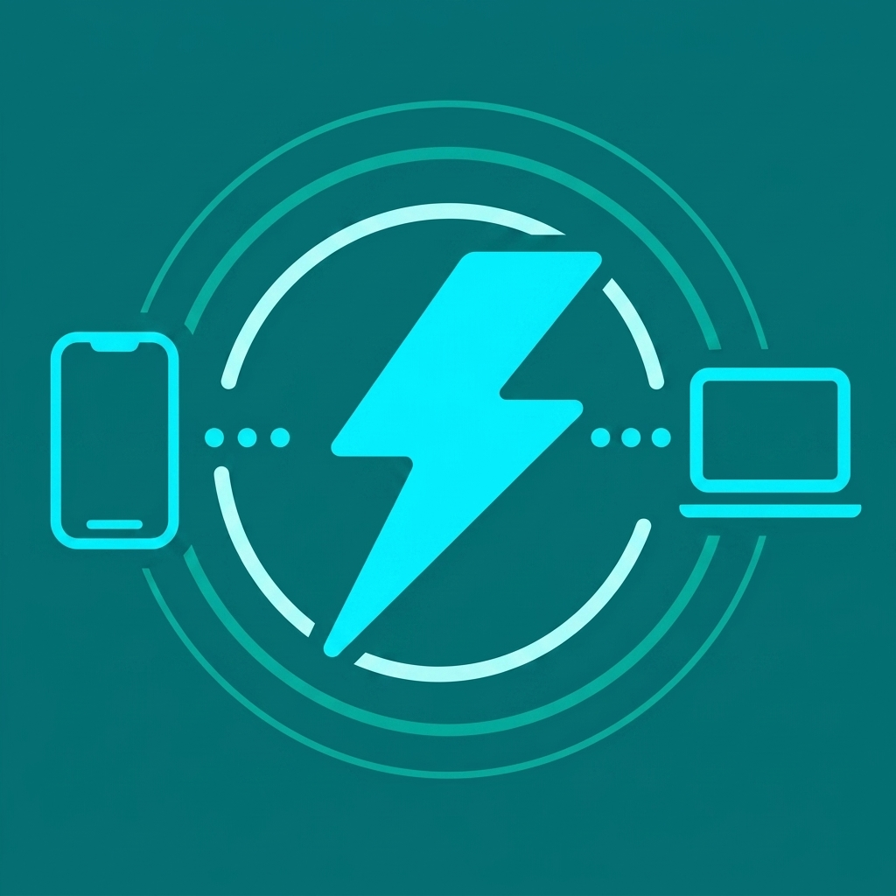
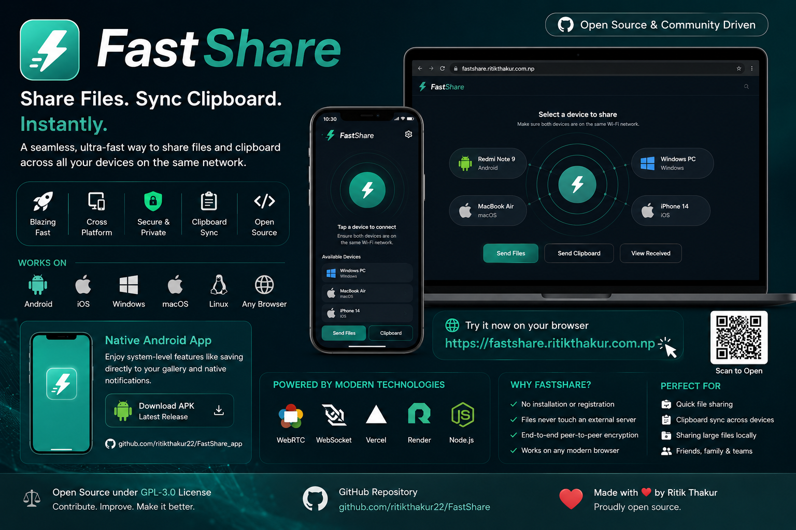

<div align="center">
  

  # 🚀 FastShare
  **A seamless, ultra-fast method to share files and clipboard across devices.**

  [](https://fastshare.ritikthakur.com.np)
  [](https://play.google.com/store/apps/details?id=com.crdy.fastshare)
  [](LICENSE)
  [](https://github.com/ritikthakur22/fastshare_app)
</div>

<div align="center">
  <h2>🌟 Introducing FastShare Pro</h2>
  
</div>

---

FastShare is an ultra-fast, peer-to-peer local file and clipboard sharing platform. It enables seamless file transfers across different devices and operating systems without any setup, registration, or cloud storage dependency. Built with simplicity, privacy, and speed in mind, FastShare connects devices on the same network instantly.

## 🌟 Live Demo

Visit the live web application here: **[https://fastshare.ritikthakur.com.np](https://fastshare.ritikthakur.com.np)**

## 📱 Official Mobile Application

FastShare is available as an official native Android app on the **Google Play Store**:

<div align="center">
  <a href="https://play.google.com/store/apps/details?id=com.crdy.fastshare">
    
  </a>
</div>

- **Google Play Store Listing:** [FastShare on Google Play](https://play.google.com/store/apps/details?id=com.crdy.fastshare)
- **Application ID:** `com.crdy.fastshare`
- **Native Android Client Repository:** [ritikthakur22/fastshare_app](https://github.com/ritikthakur22/fastshare_app)
- **Direct APK Releases:** [Latest APK Releases](https://github.com/ritikthakur22/fastshare_app/releases/latest)

## 🏗️ Architecture & Hosting

This project is built using a modern, scalable split-deployment architecture for maximum performance and reliability:

- **Frontend (Vercel):** The user interface is statically hosted on [Vercel](https://vercel.com) ensuring low-latency delivery globally through Vercel's Edge Network.
- **Backend (Render):** The WebSockets signaling server is hosted on [Render](https://render.com). It acts as an open API for matchmaking, allowing devices to discover each other securely before establishing a direct WebRTC peer-to-peer connection.

<div align="center">
  
  
  
  
</div>

## 🚀 Features

- **Blazing Fast Transfers**: Direct peer-to-peer encrypted data streams using WebRTC.
- **Cross-Platform Compatibility**: Works across Android, iOS, Windows, macOS, and Linux through any modern web browser or the native Android app.
- **Clipboard Syncing**: Seamlessly share and sync clipboard text between paired devices.
- **Zero Cloud Storage**: Files transfer directly between devices and never touch an intermediate cloud server.
- **No Account Required**: Instant peer discovery on the local network without login or registration.

## 📦 Tech Stack & Dependencies

The backend signaling server is powered by Node.js and relies on the following core packages:

| Package | Version | Description |
| :--- | :--- | :--- |
|  | `^4.18.2` | Core web framework for the signaling server |
|  | `^8.16.0` | High-performance WebSocket client & server for Node.js |
| **`express-rate-limit`** | `^7.1.5` | Basic rate-limiting middleware for Express |
| **`ua-parser-js`** | `^1.0.37` | Lightweight device and browser detection |
| **`unique-names-generator`** | `^4.3.0` | Generates random, memorable device names |

*Note: The frontend is built with vanilla HTML, CSS, and modern JavaScript for maximum performance and zero bloat.*

## 📋 Prerequisites

- **[Node.js](https://nodejs.org/)** (v15 or higher)
- **[npm](https://www.npmjs.com/)** (bundled with Node.js)
- **[Git](https://git-scm.com/)**

## 🛠 Local Setup & Installation

### 🐧🍎 Linux / macOS
```bash
# Clone the repository
git clone https://github.com/ritikthakur22/FastShare.git

# Enter the directory
cd FastShare

# Install dependencies
npm install

# Start the application
npm start
```

### 🪟 Windows
```cmd
:: Clone the repository
git clone https://github.com/ritikthakur22/FastShare.git

:: Enter the directory
cd FastShare

:: Install dependencies
npm install

:: Start the application
npm start
```

Once running, access the application at `http://localhost:3000`.

## 💡 How to Use
1. Ensure both devices are connected to the same Wi-Fi network.
2. Open FastShare ([fastshare.ritikthakur.com.np](https://fastshare.ritikthakur.com.np)) on both devices.
3. Tap on a device's icon to send files, or right-click (long-press on mobile) to send a direct message or clipboard text.

## 🌐 Custom Signaling Server (Self-Hosting)

FastShare relies on a central **Signaling Server** to help devices discover each other and establish a secure, peer-to-peer WebRTC connection. Once connected, files are transferred directly between devices and never touch the server.

By default, FastShare uses our public signaling server hosted on Render (`wss://fastshare-ja1a.onrender.com`). **For most users, simply leave the "Signaling Server URL" setting blank.** The app will automatically connect and work seamlessly out of the box.

### Why use a custom server?
Privacy-conscious users or corporate networks can self-host the FastShare backend on their own hardware (such as a Raspberry Pi, NAS, or private server):
1. Run the backend using Node.js or Docker on your local network.
2. Open the FastShare settings on your devices.
3. Enter your local server's WebSocket URL (e.g., `ws://192.168.1.50:3000`) in the **Signaling Server URL** field.

This allows FastShare to work **entirely offline** without an internet connection, provided the devices are connected to the same local router.

## 📄 License & Terms of Use

This project is licensed under the **FastShare Software License Agreement** - see the [LICENSE](LICENSE) file for complete terms:

- **Personal & Educational Use:** Free to run, study, and self-host for personal, non-commercial purposes.
- **Explicit Prohibition:** You may NOT publish, republish, distribute, upload, or make available this software, or any derivative works or builds, on the **Google Play Store**, Apple App Store, or any app store without prior written authorization from Ritik Thakur.
- **Commercial Exploitation:** Commercial redistribution, reselling, or monetization without explicit written authorization is strictly prohibited.

For inquiries or authorization, contact [Ritik Thakur](https://www.ritikthakur.com.np).

## 👏 Credits & Attributions
FastShare is inspired by and derived from open-source peer-to-peer WebRTC innovations, including [PairDrop](https://github.com/schlagmichdoch/PairDrop) and Snapdrop.
